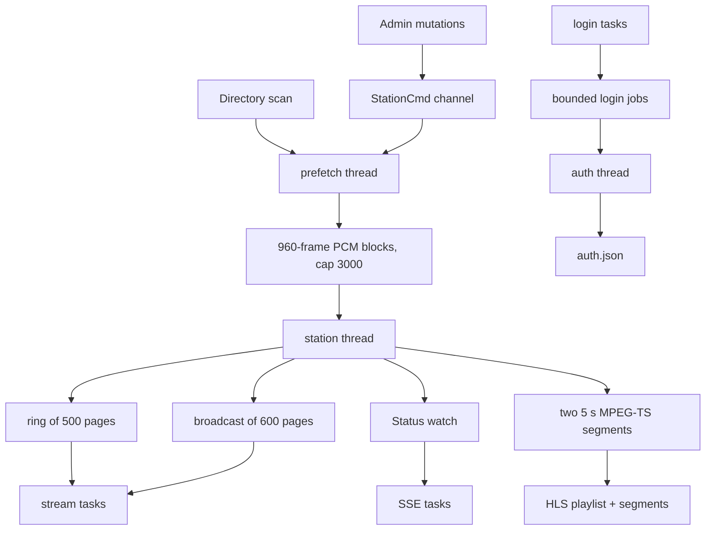

# Architecture

One Tokio runtime and three named OS threads share the process. HTTP never touches PCM or the encoder, and the audio threads never touch sockets. Argon2 runs only on `auth`. The audio threads share the bounded PCM channel and `Shared`; HTTP sends account jobs to `auth` over a bounded channel and waits for a oneshot reply.

The prefetch thread owns the `Vec<Track>` library and jingle list, the `VecDeque<Track>` schedule, the `last_end` cooldown map, the decoder state, and the `Mixer`. It decodes each file once, records the silence envelope, keeps the last 15 seconds of output audio for the crossfade, and then calls `posix_fadvise(POSIX_FADV_DONTNEED)` on Linux to drop the file's cached pages.

The station thread owns the `Encoder`, `PageWriter`, HLS segmenter, frame and sequence counters, and pending now-playing announcements. It blocks on the PCM channel until 500 blocks (ten seconds) have been encoded, publishing each page into the ring as it goes, then records `pace_start`. From then on, a page is released no earlier than `pace_start + (frames_done - 500) * 20 ms`. The PCM channel holds 3000 blocks, sixty seconds of audio. When it fills, the prefetch thread blocks in `Mixer::commit`.

If the station thread exits, the PCM sender fails and the prefetch thread returns. If the prefetch thread exits, the station thread drains the channel, logs that the library is exhausted, and returns. Nothing restarts either thread. HTTP keeps serving with a frozen stream.

The auth thread owns the account state, hashes and verifies passwords with Argon2id, and writes `auth.json` atomically on first login. HTTP tasks enqueue a job and wait for the result. `proofs/Auth.lean` covers the account state machine and its failure cases.

## Shared state

`Shared` carries the header pages, the page fan-out, the status watch, the command sender, the audio epoch, and the in-flight play list.

`head` is `OpusHead` and `OpusTags` concatenated once at startup. `ring` is a `Mutex<VecDeque<(seq, Bytes)>>` capped at 500 pages. `push` drops the oldest page at the cap and sends the new page to the broadcast channel. A send with no receivers is ignored. `burst` clones the ring for a new listener. Sequence numbers start at one and increase.

`tx` is a Tokio broadcast channel with capacity 600 pages, or twelve seconds. A receiver that falls behind gets `RecvError::Lagged` and resumes from the oldest page still buffered. The stream task skips anything at or below its last written sequence. A slow socket loses audio instead of applying backpressure to the station.

`status` is a Tokio watch channel holding a rendered `Status`. Rendering produces the admin JSON bytes, the admin SSE frame (`data: {...}\n\n`), and the smaller public SSE frame in one pass. `Shared::update` runs a closure and wakes watchers only when one of the frames changes. The admin form carries the listener list, the first 25 queued tracks, and `queue_total`. The public form carries the listener count and the now-playing track.

`cmd` is an `mpsc::Sender<StationCmd>` behind a mutex. `notify` is called from async HTTP tasks. The prefetch thread drains it without blocking before each scheduling decision. It blocks on the channel with a five-second timeout when the library is empty, after the failure counter reaches the library size, or when it cannot select a track.

`audio_epoch_ms` is set once, when the station primes its ring. It maps the mixer's audio timeline to wall-clock playout. The scheduler uses it to place top-of-hour jingles. `inflight` holds tracks and jingles handed to the encoder but not yet announced as now playing, keyed by play id. The station removes an entry when its announcement fires. The delete and rename paths update it immediately. `remaining` holds the part of the schedule that has not been handed off yet. `Shared::refresh_queue` publishes `inflight` in play order, followed by `remaining`. `/api/status` and `/api/queue` include every track between the current one and the end of the schedule, including the prefetch window.

## Listeners

`Shared::register_listener` allocates an id from an `AtomicU64` that starts at one, inserts a `Listener` into `Status`, and returns a `ListenerGuard`. The guard owns the listener's watch sender. Dropping the guard removes the entry.

Each stream task writes the headers and ring, subscribes to the broadcast, and then waits on either new pages or the listener's disconnect signal. An admin disconnect sends `true` on the watch channel, and the task returns without writing anything else.
